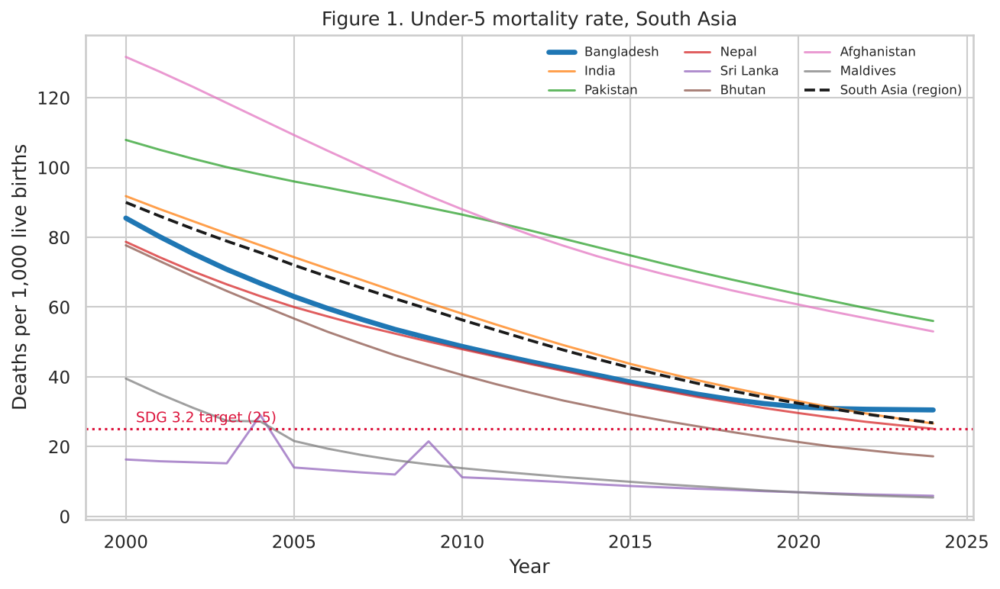
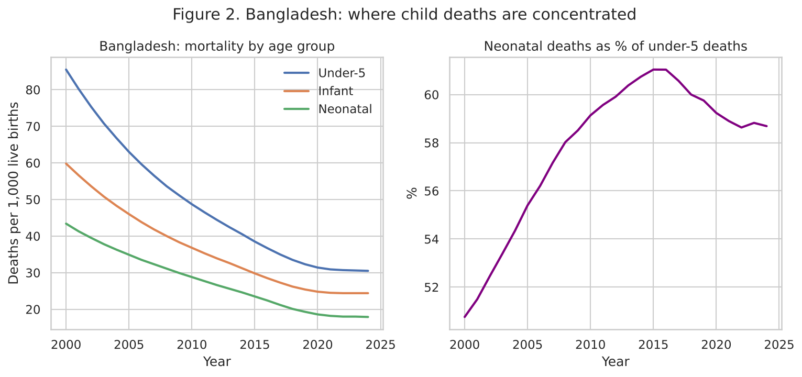
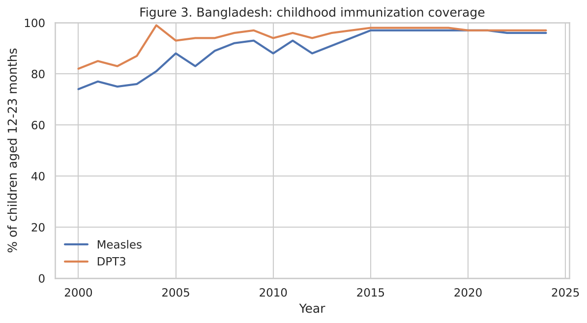
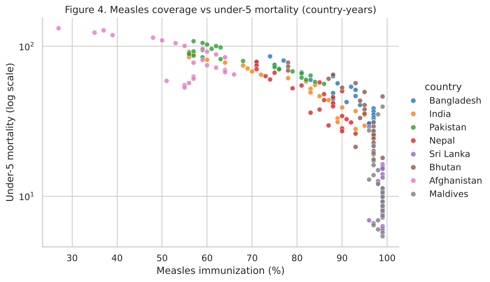
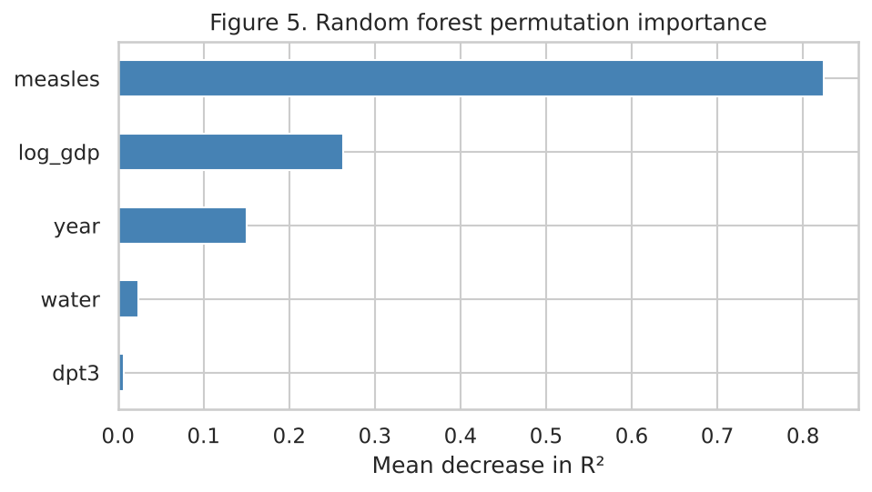

# Child Mortality and Immunization Trends in Bangladesh (2000–2024)

A reproducible statistical analysis of under-5, infant and neonatal mortality in Bangladesh, with comparison across eight South Asian countries.



## Key findings

1. **Strong long-term progress.** Bangladesh's under-5 mortality fell from 85.5 to 30.5 deaths per 1,000 live births between 2000 and 2024 (−64%), an average annual reduction of **4.5%** (95% CI 4.0–5.0).
2. **The decline slowed significantly after 2012**, from 5.6% to 3.4% per year (segmented regression, p < 0.001), and nearly stalled in 2020–2024. Bangladesh now has higher under-5 mortality than India (26.6) and Nepal (25.1).
3. **Deaths are concentrated in the first month of life.** Neonatal deaths rose from 50.8% to 58.7% of all under-5 deaths. Bangladesh is **off track for the SDG 3.2 neonatal target**: projected 14.3 per 1,000 in 2030 against a target of 12, requiring a 6.7% annual reduction versus the current 3.7%.
4. **The under-5 SDG target is uncertain**: projected 24.9 (95% CI 24.0–25.8) against a target of 25, and this assumes the 2012–2024 pace continues.
5. **Immunization: between versus within countries.** Measles coverage was associated with lower mortality across countries (pooled model: −22.8% per 10-point increase, p = 0.03), but not within countries over time once country fixed effects were added (p = 0.21), because coverage had plateaued at 96–99%.
6. **Prediction for unseen countries is unreliable.** In leave-one-country-out validation, a random forest outperformed linear regression (log-RMSE 0.55 vs 0.63), but both failed outside the training range (linear on Afghanistan, random forest on Sri Lanka).

**Implication:** further gains in child survival in Bangladesh will depend mainly on newborn care, including the prevention and treatment of neonatal infections, rather than on immunization coverage alone.

## Research questions

1. How fast has child mortality declined in Bangladesh, and has the decline slowed?
2. Is Bangladesh on track for the SDG 3.2 targets (under-5 ≤ 25 and neonatal ≤ 12 per 1,000 live births by 2030)?
3. Across South Asia, how is child mortality associated with immunization coverage, income and safe water, after accounting for country differences?
4. Can child mortality be predicted for a country the model has not seen?

## Data

Public secondary data from the [World Bank World Development Indicators](https://databank.worldbank.org/source/world-development-indicators), downloaded through its API in October 2026.

| Indicator | Code | Original source |
|---|---|---|
| Under-5 mortality rate | [SH.DYN.MORT](https://data.worldbank.org/indicator/SH.DYN.MORT) | [UN IGME](https://childmortality.org) |
| Infant mortality rate | [SP.DYN.IMRT.IN](https://data.worldbank.org/indicator/SP.DYN.IMRT.IN) | UN IGME |
| Neonatal mortality rate | [SH.DYN.NMRT](https://data.worldbank.org/indicator/SH.DYN.NMRT) | UN IGME |
| Measles immunization (% of children 12–23 months) | [SH.IMM.MEAS](https://data.worldbank.org/indicator/SH.IMM.MEAS) | [WHO/UNICEF WUENIC](https://immunizationdata.who.int) |
| DPT3 immunization (% of children 12–23 months) | [SH.IMM.IDPT](https://data.worldbank.org/indicator/SH.IMM.IDPT) | WHO/UNICEF WUENIC |
| GDP per capita (constant 2015 US$) | [NY.GDP.PCAP.KD](https://data.worldbank.org/indicator/NY.GDP.PCAP.KD) | World Bank |
| At least basic drinking water (% of population) | [SH.H2O.BASW.ZS](https://data.worldbank.org/indicator/SH.H2O.BASW.ZS) | [WHO/UNICEF JMP](https://washdata.org) |

**Countries:** Bangladesh, India, Pakistan, Nepal, Sri Lanka, Bhutan, Afghanistan, Maldives, plus the South Asia regional aggregate (for comparison only).

| | Raw | Processed |
|---|---|---|
| File | `data/raw/worldbank_indicators.csv` | `data/clean_panel.csv` |
| Format | Long: one value per row | Wide panel: one row per country-year |
| Size | 1,638 rows × 4 columns | 225 rows × 17 columns |
| Years | 2000–2025 | 2000–2024 (2025 not yet published) |

## Methods

```
Acquisition → Validation → Feature engineering → Descriptive analysis
           → Statistical modelling → Machine learning → Reporting
```

- **Acquisition:** automated World Bank API download with retries; raw snapshot cached for reproducibility.
- **Validation:** duplicate check, missing-data audit, range checks, internal consistency (neonatal ≤ infant ≤ under-5), interpolation of interior gaps only, with flags. Result: 0 duplicates, 0 failed checks, 0 values imputed.
- **Feature engineering:** log under-5 mortality, log GDP per capita, neonatal share of under-5 deaths.
- **Descriptive analysis:** summary tables and the annual rate of reduction (ARR), the UN IGME standard metric.
- **Trend analysis:** log-linear and segmented regression (break at 2012, fixed in advance) with Newey–West (HAC) standard errors.
- **SDG projection:** projection to 2030 from the post-2012 trend with 95% CIs, compared with the ARR required for each target.
- **Panel regression:** pooled OLS versus country fixed effects, cluster-robust standard errors by country, VIF check (all below 4).
- **Machine learning:** linear regression versus random forest (500 trees), leave-one-country-out cross-validation, permutation importance.

## Figures

| | |
|---|---|
|  |  |
|  |  |

## How to run

```bash
pip install -r requirements.txt
jupyter notebook child_mortality_bangladesh.ipynb
```

The notebook also runs on Kaggle or Google Colab: upload it, turn internet access on, and run all cells. If `data/raw/worldbank_indicators.csv` exists, it is reused; set `REFRESH = True` in the configuration cell to download fresh data.

## Repository structure

```
child_mortality_bangladesh.ipynb   analysis notebook (with outputs)
data/raw/worldbank_indicators.csv  raw data snapshot
data/clean_panel.csv               cleaned country-year panel
figures/                           figures 1–5
results/summary.txt                key findings in plain text
results/results.json               all key numbers
requirements.txt                   Python dependencies
```

## Limitations

- Mortality figures are modelled UN IGME estimates, not direct counts, so confidence intervals from trend models understate true uncertainty.
- The cross-country analysis is ecological: it describes country averages, not individual children, and shows associations, not causal effects.
- With only eight countries, cluster-robust inference is approximate.
- The 2012 break year was fixed in advance; the SDG projection assumes the recent trend continues unchanged.

## Possible extensions

- Individual-level analysis with Bangladesh DHS or MICS microdata (child survival by maternal education, birth spacing, facility delivery).
- Joinpoint regression to estimate the break year from the data.
- Sub-national comparison across divisions.

## Author

**Md. Abdullah Mandal** · B.Sc. in Computer Science and Engineering, BAUST
[GitHub](https://github.com/Abdullah2104) · abdullahmandalm@gmail.com
